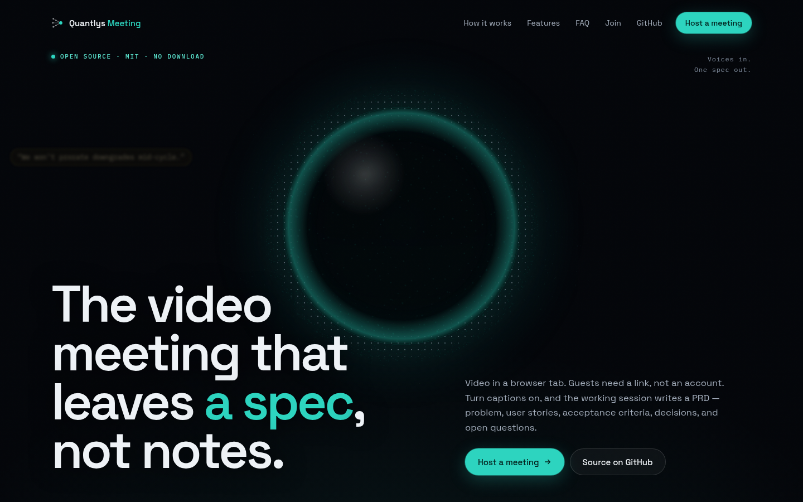

# Quantlys Meeting

[](LICENSE)
[](https://vercel.com/new/clone?repository-url=https%3A%2F%2Fgithub.com%2FSantoshA1%2Fquantlys-meet&project-name=quantlys-meet&repository-name=quantlys-meet&env=LIVEKIT_URL,NEXT_PUBLIC_LIVEKIT_URL,LIVEKIT_API_KEY,LIVEKIT_API_SECRET,NEXT_PUBLIC_SUPABASE_URL,NEXT_PUBLIC_SUPABASE_ANON_KEY,SUPABASE_SERVICE_ROLE_KEY,DEEPGRAM_API_KEY,OPENROUTER_API_KEY,CRON_SECRET&envDescription=LiveKit%20%28video%29%2C%20Supabase%20%28auth%2C%20database%2C%20storage%29%2C%20Deepgram%20%28captions%29%2C%20OpenRouter%20%28notes%20and%20PRD%3B%20using%20OpenAI%20instead%3F%20swap%20it%20for%20OPENAI_API_KEY%20after%20deploy%29%20and%20CRON_SECRET%20%28any%20long%20random%20string%29.&envLink=https%3A%2F%2Fgithub.com%2FSantoshA1%2Fquantlys-meet%23required-services--keys)

A browser video meeting that writes its own PRD. While you talk, it asks follow-up questions to fill gaps in the spec; when you stop, you get a markdown PRD (problem, user stories, acceptance criteria, decisions, open questions). There's also **Memory mode** for stories and notes, a private **"What did I miss?"** recap, a caption glossary for names and jargon, and recording that survives a crashed tab. Guests join from a link; only the host signs in. Bring your own keys (LiveKit, Deepgram, Supabase, OpenRouter or OpenAI).

Hosted version: [quantlys-meeting.com](https://quantlys-meeting.com) · What changed: [`CHANGELOG.md`](CHANGELOG.md) · Announce drafts (human paste only): [`docs/ANNOUNCE_DRAFT.md`](docs/ANNOUNCE_DRAFT.md)

## Demo


*AI-generated voices, recorded on the live app.* A real meeting on quantlys-meeting.com with two scripted text-to-speech voices; captions, the agent's question, the recap and the PRD are what the app produced. The soundtrack is the same TTS audio laid in sync with the screen recording. Cuts and speed-ups are labelled. Full video with sound (56 s, MP4): [`docs/images/quantlys-meeting-demo-v3.mp4`](docs/images/quantlys-meeting-demo-v3.mp4) · Also see a labeled [example PRD](https://quantlys-meeting.com/example-prd) (a specimen, not a customer recording).



## Quickstart (3 steps)

1. **Get keys.** A [LiveKit Cloud](https://cloud.livekit.io) project (URL, API key, secret), a [Supabase](https://supabase.com) project (URL, anon key, service-role key), a [Deepgram](https://deepgram.com) key, and an [OpenRouter](https://openrouter.ai) or OpenAI key. All have a free tier or starter credit.
2. **Set up Supabase.** In the SQL editor, paste and run all of [`supabase/schema.sql`](supabase/schema.sql). It creates every table, the rate limiter, the RLS policies and the private `recordings` storage bucket, and it's safe to re-run. Then, because hosts sign in with a 6-digit code: under **Authentication → Emails**, paste [`supabase/templates/sign-in-code.html`](supabase/templates/sign-in-code.html) into both the **Magic link** and **Confirm signup** templates (Supabase's defaults only contain a link, not the code).
3. **Deploy.** Click **Deploy with Vercel** above and paste the keys, or run it locally:

   ```bash
   git clone https://github.com/SantoshA1/quantlys-meet.git && cd quantlys-meet
   cp .env.example .env.local   # fill in the keys from step 1
   npm install && npm run dev   # Node 22+; open /host, sign in, start a meeting
   ```

Open the guest link in a second tab: both tabs should see and hear each other. More detail is in the [10-minute quickstart](#10-minute-quickstart) and [`docs/SELF_HOST.md`](docs/SELF_HOST.md).

## About this project

Quantlys Meeting is my side project. I built it because most of my spec work happens on calls, and I wanted the call itself to produce the document. I use it for my own meetings, and I open-sourced it so anyone can plug in their own keys and run their own copy.

It's the meeting app only. [Quantlys](https://www.quantlys.ai) is the name I use for my other projects, including Conclave, which stays closed; see [What is NOT included](#what-is-not-included).

## Author

I’m **Santosh Adari**, and I build and maintain this on my own.

- GitHub: [SantoshA1](https://github.com/SantoshA1)
- LinkedIn: [santoshadari](https://www.linkedin.com/in/santoshadari/)
- X: [@SantoshAdari1](https://x.com/SantoshAdari1)
- Quantlys: [quantlys.ai](https://www.quantlys.ai)

## What you get

- Real-time video/audio via **LiveKit** (Cloud or your own `livekit-server`)
- Live captions / transcription via **Deepgram**, with participant-name and per-meeting glossary boosting
- **"What did I miss?"** — a private, in-room recap of the last 5 minutes
- Auth, meeting history, and RLS via **Supabase**
- Recordings made in the host's browser and saved to **Supabase Storage** (no LiveKit Egress or separate S3 bucket needed)
- Notes, PRD, Memory chapters/clips, and search write-ups via **OpenRouter** or **OpenAI**
- Optional invites / digests via **Resend**
- Deploy on **Vercel** (or any Node 22+ host that can run Next.js 16)

## Architecture (high level)

```
Browser (Next.js app)
  ├─ LiveKit client  ──►  LiveKit SFU (Cloud or self-hosted)
  ├─ Captions         ──►  Deepgram
  ├─ Recorder (host)  ──►  Supabase Storage `recordings` bucket (one-shot or resumable upload)
  └─ Host console     ──►  Next.js API routes
                              ├─ Supabase (Postgres + Auth + Storage, service role)
                              ├─ Deepgram (transcribe the saved take)
                              ├─ OpenRouter / OpenAI (notes, PRD, Memory)
                              └─ Resend (optional mail)
```

Recording happens in the host's browser and needs no LiveKit Egress, so it also works with a bare self-hosted `livekit-server`; see [`docs/SELF_HOST.md`](docs/SELF_HOST.md).

## 10-minute quickstart

1. **LiveKit Cloud** → project → Settings → Keys → copy URL / API key / secret.
2. **Supabase** → new project → API keys (url, anon, service_role).  
   SQL Editor: run all of [`supabase/schema.sql`](supabase/schema.sql) (tables, rate limiter, RLS, and the private `recordings` storage bucket; safe to re-run).
3. **Auth emails** → Authentication → Emails: paste [`supabase/templates/sign-in-code.html`](supabase/templates/sign-in-code.html) into the **Magic link** and **Confirm signup** templates so the email carries the 6-digit code `/host` asks for. Supabase's built-in mailer is heavily rate-limited and may only deliver to your project's team members; for anyone else, add custom SMTP (Authentication → SMTP, e.g. Resend's SMTP). Raise Storage → Settings → upload size limit above your longest take (the Free plan caps files at 50 MB).
4. **Deepgram** → API key.
5. **OpenRouter** *or* **OpenAI** → API key (notes / PRD / Memory).
6. Clone and run locally, **or** click **Deploy** above and paste vars from [`.env.example`](.env.example).

```bash
git clone https://github.com/SantoshA1/quantlys-meet.git
cd quantlys-meet
cp .env.example .env.local   # fill LiveKit, Supabase, Deepgram, model key
npm install
npm test                     # offline Maya / lib guards (Node 22+ for .ts import stripping)
npm run dev                  # open /host (sign in) + paste the guest link in a second tab
```

**Local smoke test:** `npm test` should print no `FAIL`. Then start a meeting from `/host` and open the guest link in two browser tabs: both should see and hear each other.

Set `APP_URL` to your public origin (local: `http://localhost:3000`, prod: your Vercel URL).

Full env reference: [`.env.example`](.env.example). Self-hosted SFU: [`docs/SELF_HOST.md`](docs/SELF_HOST.md).

## Required services & keys

| Service | Keys / vars | Needed for |
|---|---|---|
| **LiveKit** | `LIVEKIT_URL`, `LIVEKIT_API_KEY`, `LIVEKIT_API_SECRET`, `NEXT_PUBLIC_LIVEKIT_URL` | Anyone joining a room |
| **Supabase** | `NEXT_PUBLIC_SUPABASE_URL`, `NEXT_PUBLIC_SUPABASE_ANON_KEY`, `SUPABASE_SERVICE_ROLE_KEY` | Host auth, history, RLS |
| **Deepgram** | `DEEPGRAM_API_KEY` | Live captions / transcripts |
| **OpenRouter or OpenAI** | `OPENROUTER_API_KEY` or `OPENAI_API_KEY` | Notes, PRD, Memory, search write-up |
| **S3-compatible** (not needed) | `S3_*` | Leftover from an older LiveKit Egress path; recordings go to the Supabase `recordings` bucket |
| **App URL** | `APP_URL` | Invite/share/callback links (falls back to the request origin if unset) |
| **Cron** | `CRON_SECRET`, `RECORDING_RETENTION_DAYS` | Nightly cleanup and Monday weekly digest (Vercel Cron); both refuse to run without `CRON_SECRET`. Cleanup deletes recordings older than `RECORDING_RETENTION_DAYS`; unset = keep until the host deletes them. `?dry=1` previews. |
| **Resend** (optional) | `RESEND_API_KEY`, `RESEND_FROM` | Invites, digest, email-the-spec |
| **Guest policy** | `ALLOW_GUEST_JOIN`, `NEXT_PUBLIC_ALLOW_GUEST_JOIN` | Unsigned guest token mint (default on) |

Optional: `NOTES_MODEL`, `AGENT_MODEL`, `CATCHUP_MODEL`, `ALLOWED_EMAIL_DOMAIN`, `SPEC_EMAIL_SECRET`, `NEXT_PUBLIC_APP_URL`.

## Deploy notes (Vercel)

1. Import the repo (or use the Deploy button).
2. Paste every required key from `.env.example`.
3. Set `APP_URL` / `NEXT_PUBLIC_APP_URL` to the deployment URL.
4. Keep `ALLOW_GUEST_JOIN` and `NEXT_PUBLIC_ALLOW_GUEST_JOIN` in sync.
5. Cron routes are declared in [`vercel.json`](vercel.json) (`/api/cron/cleanup`, `/api/digest/weekly`). Protect them with `CRON_SECRET`.

Any host that can run `next build && next start` works; Vercel is the path this repo dogfoods.

## Upgrading

Read [`CHANGELOG.md`](CHANGELOG.md) before you upgrade. **v1.1.0** adds features only: no migration, no new env vars (optional `CATCHUP_MODEL`). **v1.0.1 is a security update**, and it needs:
- Node.js 22+
- `npm install`
- the Supabase migration `supabase/migrations/20261012_rate_limits.sql` (rate-limit table)
- a redeploy

**Older self-host missing a table or column?** Re-run [`supabase/schema.sql`](supabase/schema.sql). It only adds what's missing (tables, columns, indexes, functions, policies, the `recordings` bucket) and never drops or rewrites anything.

## Guest join

- `ALLOW_GUEST_JOIN` (server) gates unsigned token mint. **Unset / true = guests ON**. Set `false` to require sign-in.
- `NEXT_PUBLIC_ALLOW_GUEST_JOIN` mirrors that for the landing guest card.
- Waiting room, meeting lock, and host admit still apply when guests are allowed.

## What is NOT included

- **Quantlys Conclave** (and the rest of the Quantlys platform / API) stays **closed**. This repo ships a PRD writer whose rubrics are *compatible* with Conclave scoring, plus honest paste-handoff copy. There is **no** one-click “send to Conclave” API — Conclave has no import endpoint for PRDs.
- **Production Quantlys Meeting secrets** (hosted `quantlys-meeting.com` keys, DB, buckets) are not in this repo and must not be.
- **LiveKit Egress** is not bundled or needed: the host's browser records and uploads to Supabase Storage.
- Brand SEO pages hardcode `quantlys-meeting.com` in metadata/sitemap for the hosted product. White-label operators should point `APP_URL` at their domain and adjust metadata as needed.

## Sample PRD & extras

- In-app specimen: `/example-prd` (labeled not a customer recording).
- In-repo mirror: [`examples/sample-prd.md`](examples/sample-prd.md).
- Whiteboard recording sidecars: `*.board.jpg` / `*.board.json` beside the video.
- Memory chapters & clips: `/host` → Memory (writers / podcasters). Per chapter: **Full video** (one continuous 1280×720/24fps HD 720p take — MP4 in Chrome/Edge/Safari, WebM in Firefox), captions `.vtt`/`.srt`, audio (`m4a`/`audio.webm` + WAV chapter/quote cuts), and the `.md` package.
- Recording: HD 720p canvas composite recorded in the host's browser, remote cameras pulled at the top simulcast layer while recording, uploaded to Supabase Storage with resumable (TUS) uploads. **Set your Supabase project's upload size limit** (Storage → Settings) above your longest take (~1.1 GB/hour / ~19 MB/min at 720p); the Free plan caps files at 50 MB, and the room then offers the take as a local download instead.
- MODNet matte spike: [`public/models/README.md`](public/models/README.md) and `npm run modnet:download`.

## License

[MIT](LICENSE) — Copyright (c) 2026 Santosh Adari.

MODNet webcam weights under `public/models/` are Apache-2.0 (upstream); see that folder’s README.

## Contributing

See [`CONTRIBUTING.md`](CONTRIBUTING.md). Sanitize / go-public checklist: [`docs/OSS_SANITIZE.md`](docs/OSS_SANITIZE.md).
